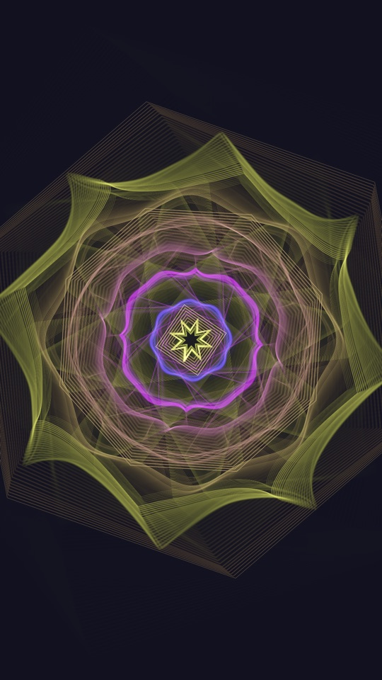

# NeanderthalVJ

An audio-reactive visualizer and VJ tool, written in Rust. Play a track or
plug in a live source, and the visuals follow the music frame by frame: the
bands, the attacks, the beat and the bar. Export what you see as an
Instagram-ready video.

<p align="center"></p>

## Visualizations

1. **Depth Point Cloud**: a scanned head as 420,000 particles, lit by the
   music, with rings behind it that answer the lows, and a head effect
   around it that never touches the face: **Orbits**, three comets on
   knotted paths built with [nannou](https://nannou.cc); **Halo**, a
   superformula crown behind the head that changes symmetry every bar; or
   **Vortex**, arms of particles spiralling up around it.
2. **Synth Cloud (Crave)**: the same head, played by a synth's oscillator:
   pulse width, LFO and timbre.
3. **Hiding Grid**: a wall of squares the music strikes, filling the
   frame. Each kick sends a shock wave across it that bulges the lattice
   and echoes off the edges; the mids turn the squares, the highs strike
   sparks, beats swell every square, and it can stand the spectrum up the
   wall like a giant analyser or lean back in perspective.
4. **Generative Geometry**: procedural shapes that grow and mutate. A ring
   for each band of the spectrum, bass at the centre; each band swells and
   sharpens its own ring, beats throw polygons outward, and every bar the
   structure evolves. Built on [nannou](https://nannou.cc)'s geometry,
   maths and randomness.

Number keys 1–4 switch between them while playing, or let **Auto-switch**
move on every few bars and at the drops.

## Install and run

NeanderthalVJ is run from its source code. You install three free tools
once; after that, one command builds the app and opens it. Copy each
command below into a terminal and press Enter.

### On a Mac

Works on Apple Silicon and Intel Macs. Open **Terminal** (press ⌘ Space,
type *Terminal*, press Enter).

**1. Install Apple's command-line tools.** A window pops up; click
*Install* and wait for it to finish. If it says they are already
installed, go on.

```bash
xcode-select --install
```

**2. Install Rust**, the language the app is written in:

```bash
curl --proto '=https' --tlsv1.2 -sSf https://sh.rustup.rs | sh -s -- -y
```

Then make it available in this Terminal window:

```bash
source "$HOME/.cargo/env"
```

**3. Download NeanderthalVJ**:

```bash
git clone https://github.com/clotairedamy/NeanderthalVJ.git
```

```bash
cd NeanderthalVJ
```

**4. Build and start it**:

```bash
cargo run --release -p nv-ui
```

The first build takes a few minutes; later starts take seconds. The app
opens in its own window. Leave Terminal open while you use it.

**5. Optional: video export.** Exporting needs
[ffmpeg](https://ffmpeg.org). With [Homebrew](https://brew.sh):

```bash
brew install ffmpeg
```

### On Windows 10 or 11

Open **PowerShell** (press the Windows key, type *PowerShell*, press
Enter). `winget` comes with Windows; if PowerShell does not know it,
install *App Installer* from the Microsoft Store.

**1. Install Microsoft's C++ build tools**, which Rust uses to make
Windows programs. This is a large download (a few GB) and can take a
while; accept the prompt that asks for permission.

```powershell
winget install --id Microsoft.VisualStudio.2022.BuildTools -e --override "--wait --passive --add Microsoft.VisualStudio.Workload.VCTools --includeRecommended"
```

**2. Install Rust and Git**:

```powershell
winget install --id Rustlang.Rustup -e
```

```powershell
winget install --id Git.Git -e
```

**3. Close PowerShell and open a new one**, so it finds what you just
installed. Then make sure Rust is ready:

```powershell
rustup default stable
```

**4. Download NeanderthalVJ**. A short folder such as your home folder,
where PowerShell starts, is best; very deep folders can hit Windows'
path-length limit.

```powershell
git clone https://github.com/clotairedamy/NeanderthalVJ.git
```

```powershell
cd NeanderthalVJ
```

**5. Build and start it**:

```powershell
cargo run --release -p nv-ui
```

The first build takes several minutes; later starts take seconds. Leave
PowerShell open while you use the app. Windows 10 and 11 already have
WebView2, which draws the controls.

**6. Optional: video export.** Exporting needs ffmpeg:

```powershell
winget install --id Gyan.FFmpeg -e
```

Then open a new PowerShell window before starting the app again.

### Next time

Open a terminal, go to the folder and start it:

```bash
cd NeanderthalVJ
```

```bash
cargo run --release -p nv-ui
```

To get the latest version first, run `git pull` in that folder.

### If something goes wrong

- **`cargo` or `git` is not recognised**: close the terminal and open a
  new one. On a Mac you can instead run `source "$HOME/.cargo/env"`.
- **Windows: `link.exe not found`**: the C++ build tools are missing or
  only half installed. Run step 1 again, then open a new PowerShell.
- **Mac: `xcrun: error` or `libclang` not found**: run step 1
  (`xcode-select --install`) again.
- **Live input hears nothing on a Mac**: macOS asks once whether Terminal
  may use the microphone. If you said no, allow it in *System Settings →
  Privacy & Security → Microphone*, then restart the app.
- **Export says ffmpeg is missing**: install it as above and open a new
  terminal. If it lives somewhere unusual, set `NV_FFMPEG` to its path.
- **Always use `--release`.** Without it the build is unoptimised, and
  finding the beats in a song takes minutes instead of seconds.

For anything else, [open an issue](https://github.com/clotairedamy/NeanderthalVJ/issues)
with what you ran and what the terminal printed.

## Using it

- **Load a track** from the Source tab, or drop it on the window. WAV,
  FLAC, MP3, AAC/M4A and ALAC decode; 44.1 and 48 kHz play untouched.
  The transport changes the speed, with the key kept or moving like a
  turntable, and loops.
- **Live input**: in the Source tab, pick a device and switch on *Listen
  to live input*. A line in, a microphone or a loopback device is captured
  in stereo, with gain and a gate; nothing is played back, so it cannot
  feed back. The beat and the tempo are followed live.
- **Export**: the Export tab renders the track at the current settings as
  a 1080×1920 Reel or a 1080×1080 post, H.264 and AAC at 60 fps. It needs
  [ffmpeg](https://ffmpeg.org): `brew install ffmpeg` on a Mac,
  `winget install Gyan.FFmpeg` on Windows, or point `NV_FFMPEG` at one. It
  uses the hardware encoder when the machine has one that works.
- **Orbit** the head by dragging the stage, or let **Auto camera** do it;
  scroll to zoom. **Performance** hides the controls.
- **Presets**: nine looks ship with the app, and any look can be saved
  and reloaded. The last session comes back at the next launch.
- **Colours**: a palette per mode, the colours pulled from any picture
  (pick one or drop it on the window), or three picked by hand.
- **Effects** over every mode, exports included: bloom, a flash on the
  beat, film grain on the drums, a colour split on kicks, a ghost echo and
  a vignette.

Every control in the panels has a line under it saying what it does.

### Playing it live

| Key | |
|---|---|
| 1 – 4 | Pick a visualization |
| Space | Play or pause |
| ← → | Back or on five seconds |
| F | Fullscreen |
| P | Performance: hide the controls |
| Esc | Bring everything back |

Any **MIDI controller** works with nothing to set up: notes C, C#, D and
D# pick the visualizations in any octave, E plays and pauses, F toggles
Performance, and CC 1–8 ride sensitivity, reactivity, beat impulse, bloom,
beat flash, ghost echo, the mode's own main control and the colour split.
The Source tab lists the mapping and the controllers it found.

The head model is read from `assets/` next to the program, or from
`NV_ASSETS`.

## Platforms

| | |
|---|---|
| **macOS** | Developed and tested here. |
| **Windows 10/11** | Builds and passes its checks; the interface runs in WebView2, which Windows already has. [`windows.yml`](.github/workflows/windows.yml) builds a zip on GitHub Actions. Not yet run on Windows hardware, so reports are welcome. |
| **Linux** | Not yet. The interface is a transparent webview over a GPU surface, and WebKitGTK, which Linux uses, paints over the surface instead of letting it show through. |

To check the Windows build from a Mac:

    rustup target add x86_64-pc-windows-msvc
    cargo check --target x86_64-pc-windows-msvc --workspace --all-targets

## Layout

    crates/nv-audio   real-time analysis: FFT, 7 bands, beat/BPM, synth timbre
    crates/nv-dsp     STFT, mel, onset, tempo, beat tracking, filters,
                      phase vocoder
    crates/nv-engine  decoding, playback, live input and the beat grid
    crates/nv-render  the visuals on the GPU, in WGSL, through one Scene
                      that both the window and the exporter draw with,
                      and the effects after it
    crates/nv-export  offline video export through ffmpeg
    crates/nv-ui      the interface: the control column, the stage, the
                      scope and the transport; presets, MIDI and the
                      keyboard
    crates/ads        ADS, the design system the interface is built from,
                      as Dioxus components

## Development

    cargo test --workspace

The tests need no window, no sound card and no GPU. The ones that do use a
GPU, which check the render passes against the validation layer, skip
themselves when there is none.

Format with `cargo fmt-mine`, which formats the app's crates and leaves
`ads` in its own style. Avoid `cargo fmt --all`, which would rewrite it.

Some quick ways to look at the pieces on their own:

    cargo run --release -p nv-render --example genshot -- out.png 8 1080x1920 grid fx
    cargo run --release -p nv-render --example shot -- out.png 180000 assets
    cargo run --release -p nv-render --example visualizer -- track.wav
    cargo run --release -p nv-engine --example play -- track.wav 5
    cargo run -p nv-ui --example preview -- crates/nv-ui/preview/index.html

`genshot` renders a mode (`generative`, `grid` or `head`, with `fx` for
every effect) to a PNG through the app's own `Scene`, driven by a
synthetic 120 BPM track; `play` prints the analysis as
a file plays, the quickest way to see whether it decodes, whether the
tempo was found, and whether the bands move.

See [CONTRIBUTING.md](CONTRIBUTING.md) before opening a pull request.

### Parity with the prototype

NeanderthalVJ began as a Python prototype. Its analysis and motion were
ported, not rewritten, and each ported module is pinned to the prototype by
a test: the fixtures under `crates/*/tests/fixtures` hold a deterministic
input and every output field the prototype produced, and the Rust replays
the same bytes and must agree. Continuous values are compared to float
rounding; discrete ones (beat frames, onset frames, the chosen tempo lag)
must match exactly, because a one-frame shift is a real change, not noise.

The NumPy, librosa and SciPy conventions that silently break parity if
ported the obvious way are collected in `nv-audio/src/num.rs` and `nv-dsp`:

- `np.hanning` is symmetric; `scipy.signal.get_window("hann")`, which
  librosa uses, is periodic. They differ in every sample.
- `np.std` defaults to the population denominator; librosa's onset
  normalization asks for the sample one.
- Python's `round()` is half-to-even; Rust's `f64::round` is half-away.
- `np.percentile` interpolates linearly; `astype(int)` truncates.
- librosa's mel filterbank is float32, so the whole mel/onset path is
  float32. Computing it in f64 is not more accurate; it simply disagrees.
- `librosa.time_to_frames` floors through samples; it does not round.
- `librosa.istft` offsets each frame by `-n_fft/2` rather than trimming the
  result, so the last half-window of audio survives.

## How it is put together

**The interface is a transparent webview over a GPU surface.** ADS renders
HTML, so the controls run in a Dioxus desktop webview; the visuals are drawn
by wgpu on a surface behind it, on a render thread of their own, and every
part of the page that is left transparent is a window onto them. The
interface never waits for a frame, and a frame never waits for the
interface.

**The audio callback is realtime.** It allocates nothing, locks nothing and
blocks on nothing: playback holds an `Arc` to the samples and a few atomics,
and live input writes into a ring of atomics. A speed change with the key
kept needs the track time-stretched, which takes a couple of seconds for
a whole song; that happens on another thread and the result is swapped in
through an `ArcSwap`, so the callback never waits on it. The interface derives its
clock from the playback cursor rather than running a timer of its own, so
the readout cannot drift from what is heard.

**One scene, two outputs.** The window and the exporter both draw through
`nv_render::Scene`, so an exported clip is the picture on screen rather than
a second implementation that drifts from it.

**Every control is checked.** `nv-ui/tests/settings.rs` changes each
visual setting in the mode it belongs to and fails if what the renderer is
handed does not change; a control that moves and does nothing is worse
than no control.

Settings and presets are JSON in the platform's application-data folder
(`~/Library/Application Support/NeanderthalVJ` on a Mac, `%APPDATA%` on
Windows), or in `NV_CONFIG_DIR`.

### Traps worth knowing before adding a visualization

**A pipeline must declare the pass's depth format.** Modes that draw inside
the head's render pass (the Hiding Grid, the Generative Geometry's
composite) must declare `Depth32Float` even though they never test depth,
or WebGPU rejects every draw. Nothing fails loudly; the mode simply never
appears. `nv-render/tests/gpu.rs` checks each one against the validation
layer.

**WGSL struct alignment.** A trailing `vec3<f32>` aligns to 16 bytes, so
`{vec3, f32, vec3, f32, f32, vec3}` is 64 bytes in WGSL and 48 in `repr(C)`
Rust. Nothing validates it; the head simply renders as a smooth ovoid
because every particle after the first is read from the wrong offset. Pad
with separate `f32`s instead.

**WebGPU has no point sprites.** There is no `gl_PointSize`, so each
particle is expanded into a camera-facing quad in the vertex shader and the
fragment shader cuts it to a round dot.

**The window's reported size goes stale in fullscreen.** The layout is
measured from the page (its size times `devicePixelRatio`) instead, and the
viewport is clamped to the surface, so a stale rectangle cannot fault a
frame.

### The look

ADS's dark theme is used, because the app runs in a dark room next to a lit
visualization, and its accent is white, so the chrome stays grey and the
visuals carry the colour. To bring a brand colour into the chrome, override
one token rather than touching components:

    :root[data-theme='dark'] { --accent: <colour>; }

## Licence

NeanderthalVJ is licensed under either of the [Apache License, Version
2.0](LICENSE-APACHE) or the [MIT license](LICENSE-MIT), at your option.
The head scan is by Lee Perry-Smith under CC BY 3.0; see
[NOTICE.md](NOTICE.md) for it and the other work this project includes.
